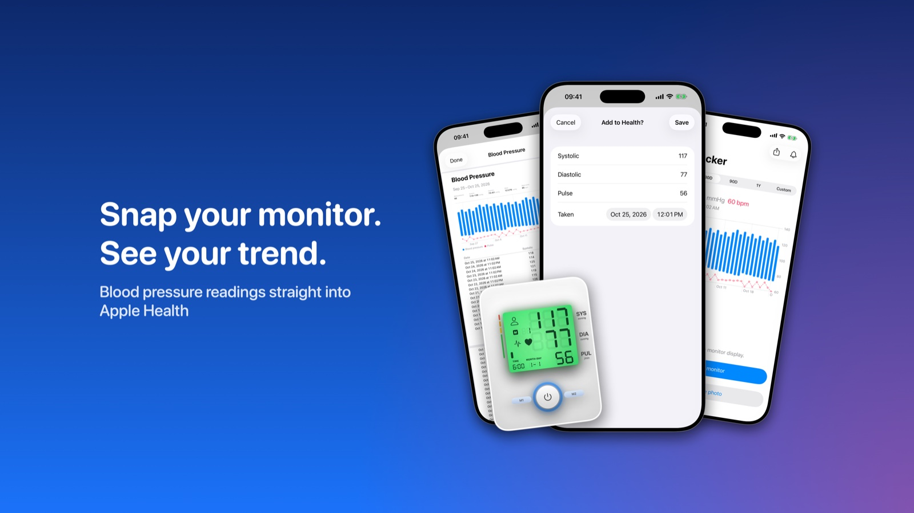
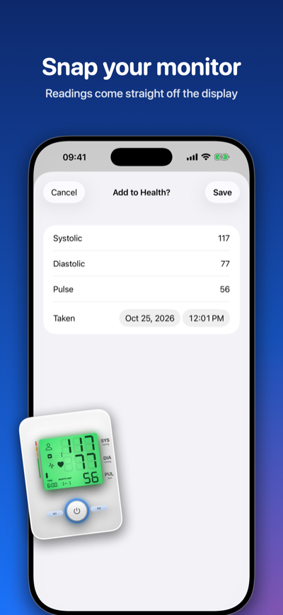
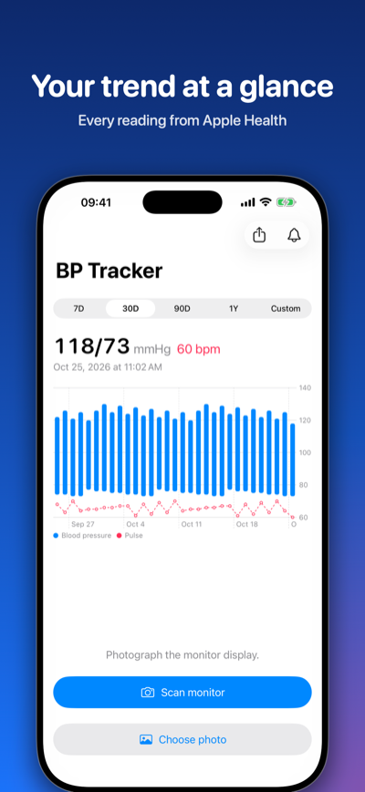
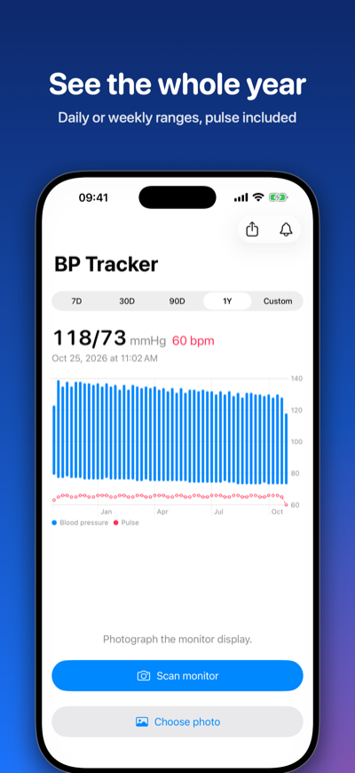
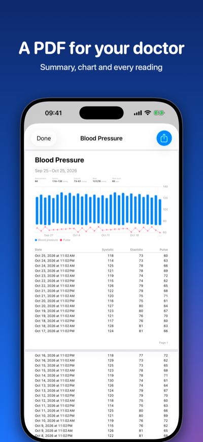
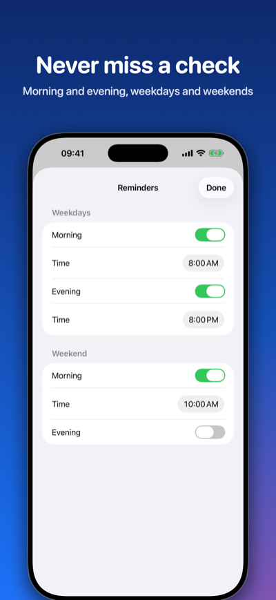

# BPTracker

[](https://apps.apple.com/app/id6826781390)

iOS app that logs blood pressure from a photo of a home monitor's display. It saves readings to Apple Health and shows charts, reminders and a PDF report.

**[Download on the App Store](https://apps.apple.com/app/id6826781390)**

<p>
  
  
  
  
  
</p>

## Reading the display

Vision locates the printed `SYS`, `DIA` and `PUL`/`PULSE` labels. The 7-segment digits beside each label are then decoded segment by segment (`BPTracker/Reader.swift`). The labels can be on either side of the digits. Any monitor with a dark-on-light LCD and those three labels stacked beside the numbers should work. A value that can't be read is left blank, never guessed.

## Supported monitors

These are verified by photos in `Checks/` (run the check below):

| Monitor | Type | SYS / DIA | Pulse | Photo |
|---|---|---|---|---|
| B.Well MED-55 | upper arm | ✅ | ✅ | `med55.png`, `med55-2.png`, `med55-3.jpg` |
| Omron HEM-7120 (same housing as M2 / 3 Series) | upper arm | ✅ | ✅ 1 of 3 photos | `omron-hem7120*.jpg` |
| Omron M2 Plus | upper arm | ✅ | ✅ | `omron-m2-plus.jpg` |
| Omron M3 | upper arm | ✅ | ✅ | `omron-m3.jpg` |
| Omron R6 | wrist | ✅ | ✅ | `omron-r6.jpg` |
| Sanitas (wrist) | wrist | ✅ | ✅ | `sanitas-wrist.jpg` |
| Microlife (Gentle+) | upper arm | ✅ | ❌ digit touches the slanted LCD edge | `microlife.jpg` |

In the Omron HEM-7120 photos where pulse isn't read, the pulse digits are in the shadow at the bottom edge of the LCD.

### Tested, not supported yet

| Monitor | Why |
|---|---|
| Beurer BM26, Medisana, Omron M3 (glare photo) | Strong glare washes out the segments. A photo taken at an angle to the light reads fine |
| NAIS wrist monitors | Pulse label is `P/min` |
| Omron HEM-7000 (Asian market) | Chinese labels |
| Backlit displays (light digits on dark), LED displays (InBody, Welch Allyn) | Reader expects dark segments on a light LCD |
| Small or low-resolution photos | Vision can't find the labels |

### Popular monitors, not tested

These come from the 2026 best-seller and review lists ([AARP](https://www.aarp.org/health/conditions-treatments/best-blood-pressure-monitors/), [Cleveland Heart](https://clevelandheart.com/best-blood-pressure-monitors), [radcity](https://radcity.net/best-home-blood-pressure-monitors-2026/)):

- **Omron 3 / 5 / 7 / 10 Series, Platinum**: same LCD layout as the supported Omrons. Expected to work.
- **A&D UA-651 / Premium**: SYS/DIA/PUL labelled LCD. Expected to work, but no test photo yet.
- **Beurer BM57**, **iHealth Track**: labelled LCD. Untested.
- **Withings BPM Connect / Core**: values on an LED matrix with no labels. Not supported. These sync to Health on their own.

Monitor names are used only to describe compatibility. B.Well, Omron, Microlife, Sanitas and the other brands named here are trademarks of their respective owners. This project isn't affiliated with or endorsed by them.

To add a monitor, put a sharp, glare-free photo in `Checks/`, add its expected values to `fixtures` in `Checks/main.swift`, and run the check.

## Checking and editing values

Before saving, the form checks each value. A reading can't be saved with systolic outside 50–300, diastolic outside 20–250, pulse outside 25–250, or systolic not above diastolic. These limits catch typos; they aren't medical ranges. Values that are possible but unusual (systolic outside 80–200, diastolic outside 40–130, pulse outside 40–150, or a systolic–diastolic gap outside 15–100) get a hint to check them, and can still be saved. Limits live in `Limits` in `BPTracker/Reader.swift`.

**History** lists the readings in the selected range. Tap a reading to edit it, swipe to delete it. Health has no way to change a saved reading, so an edit saves the new reading first and then deletes the old one. Only readings this app saved can be changed: Health doesn't let an app delete another app's data.

Each reading is saved with an ID in its metadata, on the blood pressure and on the pulse, so the pulse is edited and deleted together with its reading. Readings saved before this keep their pulse link only when the pulse has exactly the same time and nothing else shares it.

## Checks

```sh
swiftc -target arm64-apple-macos15.0 BPTracker/Reader.swift BPTracker/TrendView.swift BPTracker/Health.swift Checks/main.swift -o /tmp/reader_check && /tmp/reader_check   # photos, chart buckets, value checks, pulse links
/tmp/reader_check photo.jpg   # print what the reader sees in any photo
```

## Photo credits

The `med55*` and `omron-m2-plus.jpg` photos are our own. The other photos come from Wikimedia Commons. Some were cropped or scaled down for the checks. Changed versions are shared under the same license as the originals.

| File | Author | License | Source |
|---|---|---|---|
| `omron-hem7120.jpg` | Amit article21 | [CC BY-SA 4.0](https://creativecommons.org/licenses/by-sa/4.0/) | [Souravdeep.jpg](https://commons.wikimedia.org/wiki/File:Souravdeep.jpg) |
| `omron-hem7120-2.jpg` | Henrique Lincon | [CC0 1.0](https://creativecommons.org/publicdomain/zero/1.0/) | [Imagem pressao 5.jpg](https://commons.wikimedia.org/wiki/File:Imagem_pressao_5.jpg) |
| `omron-hem7120-3.jpg` | Henrique Lincon | [CC0 1.0](https://creativecommons.org/publicdomain/zero/1.0/) | [Imagem pressao 4.jpg](https://commons.wikimedia.org/wiki/File:Imagem_pressao_4.jpg) |
| `omron-m3.jpg` | Dmitry G | [CC BY-SA 3.0](https://creativecommons.org/licenses/by-sa/3.0/) | [Display of Omron M3 20151122.jpg](https://commons.wikimedia.org/wiki/File:Display_of_Omron_M3_20151122.jpg) |
| `omron-r6.jpg` | Amirhossein Ashrafzadeh | [CC BY-SA 4.0](https://creativecommons.org/licenses/by-sa/4.0/) | [Blood Pressure & Heart Rate on Omron R6 20150222.jpg](https://commons.wikimedia.org/wiki/File:Blood_Pressure_%26_Heart_Rate_on_Omron_R6_20150222.jpg) |
| `sanitas-wrist.jpg` | Jacek Halicki | [CC BY-SA 4.0](https://creativecommons.org/licenses/by-sa/4.0/) | [2017 Sfigmomanometr elektroniczny.jpg](https://commons.wikimedia.org/wiki/File:2017_Sfigmomanometr_elektroniczny.jpg) |
| `microlife.jpg` | Jacek Halicki | [CC BY-SA 4.0](https://creativecommons.org/licenses/by-sa/4.0/) | [2020 Sfigmomanometr elektroniczny.jpg](https://commons.wikimedia.org/wiki/File:2020_Sfigmomanometr_elektroniczny.jpg) |

## License and disclaimer

Copyright © 2026 Mikhail Samarin. All rights reserved. This repository is published for viewing only, as a portfolio. No license is granted to use, copy, modify or publish the code or its assets. See [LICENSE](LICENSE). The third-party photos above keep their own licenses.

**Not a medical device.** BP Tracker doesn't diagnose, treat or prevent any condition. It can misread a display, so always check values against your monitor and ask a doctor about your blood pressure. The software is provided "as is", without warranty of any kind, and the author isn't liable for any use of it.
